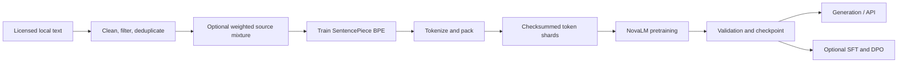

# NovaLM

NovaLM is a decoder-only language-model stack implemented in PyTorch. It includes a project-trained SentencePiece BPE tokenizer, a local text preparation pipeline, a reference Transformer with optional research variants, single-process training and checkpoint resume, evaluation, generation, post-training starters, and FastAPI serving.

This repository is still under development. It does not include a pretrained checkpoint or a bundled corpus. Synthetic tests and smoke benchmarks verify code paths; they do not demonstrate language quality. See the [specification audit](docs/spec_audit.md) for acceptance status and outstanding requirements. The [NovaLM algorithms and API reference](docs/novalm_reference.md) inventories the implemented algorithms, functions, methods, attributes, defaults, and configuration values.

## Pipeline



## Architecture

Default blocks use pre-normalization, RMSNorm, grouped-query causal attention with QK-Norm and RoPE, SwiGLU, and residual connections. The model supports naive attention and PyTorch SDPA, optional learned absolute positions, LayerNorm, GELU, MTP heads, top-k MoE, and a latent-attention research variant. GQA cache values are stored at KV-head width; MLA stores compressed latent values.

The architecture implementations are reference-scale. The MoE loop is intentionally readable rather than optimized. The `flash` attention setting uses PyTorch SDPA dispatch; a separately installed FlashAttention package backend has not been validated.

## Setup and checks

Python 3.11 or newer is supported. Install the package and optional development/serving dependencies:

```bash
python -m venv .venv
python -m pip install -e ".[dev,serve]"
python -m unittest discover -s tests -v
python -m pytest
python -m ruff check novalm scripts tests benchmarks
```

The unittest suite also runs without pytest. The project checks cover model math and gradients, cache equivalence, tokenizer/data pipeline smoke cases, checkpoint resume, validation logging, activation checkpointing, API streaming, static same-length batching, packed INT4 inference, and synthetic integrated MTP/MoE/MLA training. The dev extra installs pytest and Ruff for the preferred checks.

## Data preparation

Use only data whose license and provenance permit your intended use. No corpus is included. For a single source, edit `configs/data/pretraining.yaml`. For multiple sources and a seeded weighted stream, use `configs/data/pretraining_mixture.yaml` after replacing the source paths and license identifiers.

```bash
python scripts/prepare_data.py --config configs/data/pretraining.yaml
python scripts/train_tokenizer.py --config configs/data/tokenizer.yaml
python scripts/tokenize_dataset.py --input data/processed/train.jsonl --tokenizer data/tokenizer/novalm.model --output data/processed/tokens.jsonl
python scripts/build_shards.py --input data/processed/tokens.jsonl --output-dir data/shards/train --block-size 512
```

The tokenizer must be trained on the project corpus; NovaLM does not silently reuse a pretrained tokenizer. Preparation records source/license/language, quality filtering, exact hashes, and optional MinHash near-deduplication. Shard manifests include token counts, tokenizer metadata, mixture counts, and checksums. Weighted streams do not oversample exhausted sources, so final ratios may differ from configured weights.

## Train and evaluate

Use `configs/model/debug.yaml` for CPU smoke work or the 30M/100M model configs for larger runs. Training supports validation shards, deterministic resumable shuffling, activation checkpointing, accumulation, AMP, and periodic checkpoints.

```bash
python scripts/sanity_check.py --output experiments/reports/one_batch_overfit_cpu.json
python scripts/train.py --config configs/model/novalm_30m.yaml --training-config configs/training/single_gpu.yaml --shards data/shards/train --validation-shards data/shards/validation --steps 1000 --batch-size 1 --checkpoint experiments/runs/baseline/checkpoint.pt --best-checkpoint experiments/runs/baseline/best.pt
python scripts/evaluate.py --checkpoint experiments/runs/baseline/checkpoint.pt --config configs/model/novalm_30m.yaml --shards data/shards/validation
```

Training runs write metrics, model/training configs, environment metadata, command, and a Git commit marker. Exact shuffled-data resume is tested for the single-process, zero-worker loader used by the CLI. A bounded PyTorch profiler mode is available with `--profile`. Under `torchrun`, the CLI initializes DDP, shards the deterministic sampler by rank, and restricts checkpoints and run metadata to rank zero; use the same world size when resuming.

## Generate and serve

```bash
python scripts/generate.py --checkpoint checkpoints/latest.pt --config configs/model/novalm_30m.yaml --tokenizer data/tokenizer/novalm.model --prompt "Hello" --max-new-tokens 64
python scripts/serve.py --checkpoint checkpoints/latest.pt --config configs/model/novalm_30m.yaml --tokenizer data/tokenizer/novalm.model
```

The API exposes `/health`, `/v1/model/info`, `/v1/completions`, and `/v1/chat/completions`; completion routes support server-sent event streaming. Generation includes temperature, top-k, top-p, min-p, repetition penalty, EOS, and stop-sequence controls through the Python API.

## SFT and preference tuning

SFT JSONL records contain a `messages` array with role/content objects. User/system/tool tokens are masked from loss; assistant content is supervised. DPO JSONL records contain `prompt`, `chosen`, and `rejected`. Both are starter research paths and need held-out evaluations on appropriate data.

```bash
python scripts/sft.py --config configs/model/novalm_30m.yaml --data data/processed/sft.jsonl --tokenizer data/tokenizer/novalm.model --base-checkpoint checkpoints/latest.pt --checkpoint checkpoints/sft.pt
python scripts/dpo.py --config configs/model/novalm_30m.yaml --data data/processed/preferences.jsonl --tokenizer data/tokenizer/novalm.model --base-checkpoint checkpoints/sft.pt --checkpoint checkpoints/dpo.pt
```

## Benchmarks and experiments

```bash
python benchmarks/attention.py
python benchmarks/kv_cache.py
python benchmarks/architecture.py
python benchmarks/training.py
python benchmarks/quantization.py
python scripts/benchmark.py --suite inference
python scripts/benchmark.py --suite memory --config configs/model/debug.yaml
python scripts/benchmark.py --suite moe
python scripts/inspect_data.py data/shards/train/manifest.json
```

Raw smoke reports are stored under `experiments/reports/`. They record local hardware and configuration and should not be generalized beyond those runs. [Ablation notes](docs/ablations.md) distinguish implementation checks and systems measurements from quality results; no real-corpus quality ablation is reported.

## Limitations and roadmap

The code passes CPU tests and synthetic end-to-end checks, but the spec's definition of done remains outstanding. This working tree has only a tiny Wikipedia summary smoke corpus and a pipeline run, not suitable scale for meaningful 30M pretraining or held-out language-quality results. SFT/DPO/MTP/MoE/MLA quality comparisons, distributed trainer integration, serving-side batching, and a dedicated FlashAttention package backend remain incomplete. INT4 is an experimental weight-only reference path: it stores packed weights and dequantizes for each forward, so it is not a fast low-bit kernel. These gaps are tracked in [`docs/spec_audit.md`](docs/spec_audit.md).

## License

The NovaLM source code is distributed under the MIT License in [LICENSE](LICENSE). Dataset and tokenizer artifacts are separate: users must verify and record the licenses of their source corpora.
